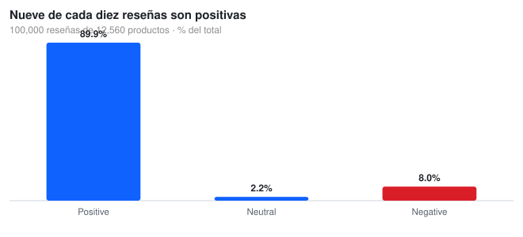
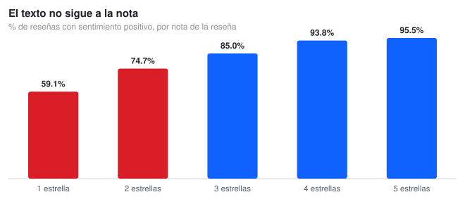
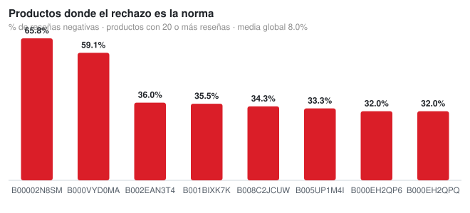

# Customer Sentiment Analysis — Product & Ops Improvement Drivers

**100,000 reviews → which products to fix first, and which signal to trust**

[](https://www.python.org/)
[](https://pandas.pydata.org/)
[](https://opensource.org/licenses/MIT)

---

## 📊 Interactive report

**[Open the interactive report →](https://nicolenki7.github.io/Customer-Sentiment-Analysis-Product-Improvement-Drivers/report.html)** — filters, charts and the table behind them, rebuilt from the committed CSVs.

---

## The business question

A catalogue with **100,000 reviews** cannot be read by hand, but it can be prioritised. The question is not *what customers think* but **which products to fix first — and which signal to believe**. Star ratings and text sentiment disagree far more often than anyone assumes, and picking the wrong one sends the ops team to the wrong SKU.



---

## What the data says

### The catalogue is overwhelmingly positive

**89.9%** of the 100,000 reviews are positive, 8.0% negative and 2.2% neutral. That 8% is the entire complaint universe: **7,987 reviews**. When the baseline is this high, ranking by raw negative counts is useless — everything has a few bad reviews.

### The uncomfortable finding: the text does not follow the stars



**59.1% of one-star reviews carry positive sentiment** (5,506 of 9,318), rising to 74.7% at two stars. At the other end, only 3.3% of four- and five-star reviews read as negative. The mean VADER compound score never goes negative — not even at one star: **0.184 → 0.428 → 0.590 → 0.742 → 0.777** across the five ratings.

The reason is what each signal measures. VADER scores the **tone of the text**; the star scores **satisfaction with the purchase**. A typical one-star food review says *"the product tastes great but arrived open and expired"*: positive words dominate the text while the experience was a disaster. **Sentiment cannot replace ratings, and ratings cannot explain the text.** You need both.

### Where the rejection concentrates



Requiring at least **20 reviews** — otherwise two bad reviews look like a crisis — leaves 899 of 12,560 products. Against a global 8.0% negative rate, the worst product reaches **65.8%** (B00002N8SM, 38 reviews) and the second **59.1%** (B000VYD0MA, 22). A handful of SKUs explains a disproportionate share of the complaints.

---

## Reproduce it

```bash
git clone https://github.com/Nicolenki7/Customer-Sentiment-Analysis-Product-Improvement-Drivers.git
cd Customer-Sentiment-Analysis-Product-Improvement-Drivers

python -m venv .venv && source .venv/bin/activate
pip install -r requirements.txt

python src/sentiment_drivers.py     # the three SVG charts in this README
python src/sentiment_analysis.py    # extended set: 6 PNG figures + outputs/insights.md
```

The 100k-review CSV is committed, so nothing is downloaded and the numbers are reproducible as-is.

---

## Repo layout

```
Sentiment_Analysis_and_Satisfaction_Drivers_in_E_commerce_Reviews.ipynb
                                    notebook: census, text/rating conflict, priority list
src/sentiment_drivers.py            the three charts in this README (SVG)
src/sentiment_analysis.py           extended exploratory set (6 PNG + insights.md)
src/svg_chart.py                    tiny dependency-free SVG bar chart generator
reviews_sentiment_TRANSFORMADO_ROBUSTO_100k.csv   100,000 scored reviews
docs/img/*.svg                      charts used here
outputs/figures/*.png               extended figures
outputs/insights.md                 auto-generated summary
```

---

## Method

- **Scoring.** VADER `compound_score` per review, already computed and committed with the dataset; the classification thresholds are VADER's standard ones (±0.05).
- **Conflict measure.** Cross-tab of `rating` against `sentiment_category`, reported as the share of positive sentiment per star level. That is a *proportion of the rating bucket*, not of the whole dataset, so each bar is comparable.
- **Priority list.** Negative-sentiment share per `product_id`, filtered to products with at least 20 reviews so the percentage is not noise.

---

## Limitations

- **VADER is a lexicon, not a trained model.** It misses complex negation and sarcasm, and on food reviews it skews positive because culinary vocabulary is flattering. Part of that 59% conflict is the tool, not the customers.
- The committed CSV has **no review text**, only the pre-computed scores: nothing here can be audited back to the words that triggered a score.
- The 20-review cut-off is a business decision, not a statistical one. With 899 products above it, moving the threshold reshuffles the ranking.
- No date and no category column: it cannot show whether rejection worsened over time or separate food from other departments.

## Where this would go next

Replace the lexicon with a model trained on these same star ratings (or an LLM with a few labels) and re-measure the conflict. If it drops, the tool was the problem. If it does not, then people are rating the logistics while writing about the taste — and the fix belongs to operations, not to the product team.

---

## 📆 Dataset

| File | Rows | Fields |
|:--|--:|:--|
| `reviews_sentiment_TRANSFORMADO_ROBUSTO_100k.csv` | 100,000 | `Id`, `product_id`, `rating`, `compound_score`, `sentiment_category`, `rating_category` |

Source: Amazon Fine Food Reviews, scored with VADER.

---

## 📄 License

MIT for the analysis code. The dataset keeps its original public license.
