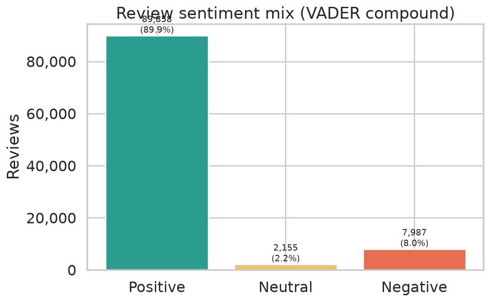
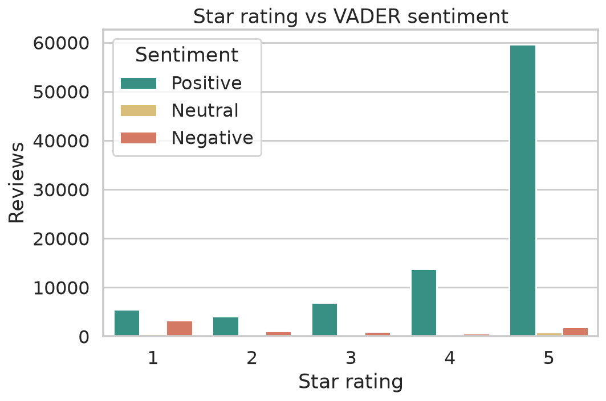
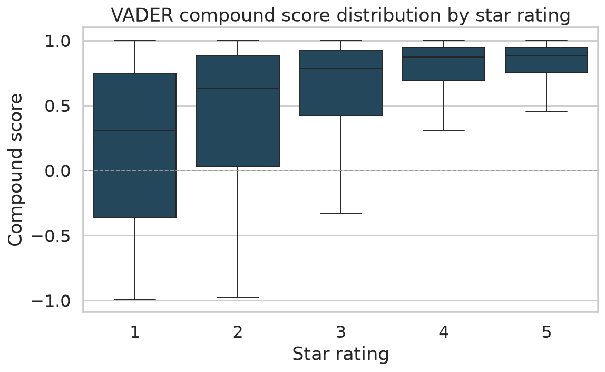
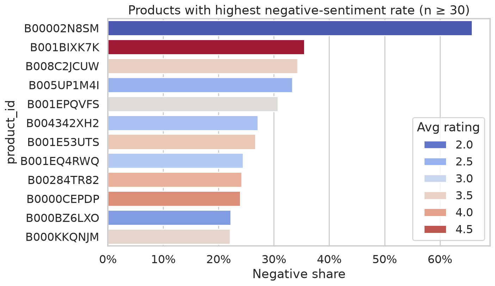
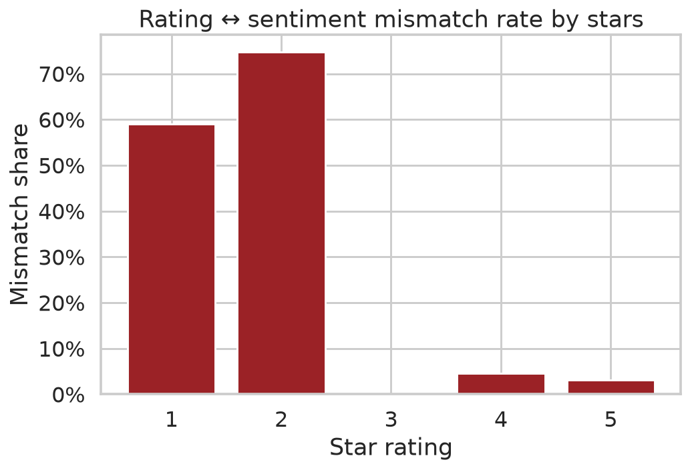
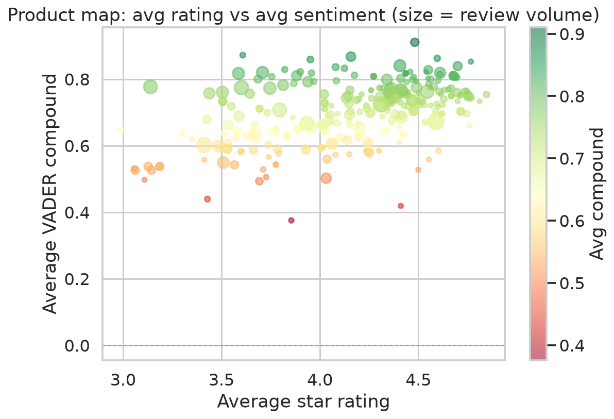

# Customer Sentiment Analysis — Product & Ops Improvement Drivers

**NLP / VADER sentiment on e-commerce reviews → prioritize which products to fix first**

[](https://www.python.org/)
[](https://pandas.pydata.org/)
[](https://opensource.org/licenses/MIT)

---

## Overview

Portfolio project that turns **~100k product reviews** into an actionable priority list:

1. Score text with **VADER** (`compound_score`)
2. Classify **Positive / Neutral / Negative**
3. Cross with **star ratings** and **product_id**
4. Surface SKUs with high **negative share + enough volume**, plus rating↔sentiment mismatches

Business question: *Where should product and ops teams look first?*

---

## Key insights

See [`outputs/insights.md`](outputs/insights.md) for the latest auto-generated snapshot.

### Charts

| | |
|:--|:--|
|  |  |
|  |  |
|  |  |

---

## Dataset

| File | Rows | Fields |
| :--- | ---: | :--- |
| `reviews_sentiment_TRANSFORMADO_ROBUSTO_100k.csv` | 100,000 | `Id`, `product_id`, `rating`, `compound_score`, `sentiment_category`, `rating_category` |

Also in the repo: original Jupyter workflow + PDF write-up (kept for history).

---

## Quickstart

```bash
git clone https://github.com/Nicolenki7/Customer-Sentiment-Analysis-Product-Improvement-Drivers.git
cd Customer-Sentiment-Analysis-Product-Improvement-Drivers

python -m venv .venv && source .venv/bin/activate
pip install -r requirements.txt

python src/sentiment_analysis.py
```

Outputs land in `outputs/figures/` and `outputs/insights.md`.

---

## Repo layout

```
reviews_sentiment_TRANSFORMADO_ROBUSTO_100k.csv
src/sentiment_analysis.py
outputs/figures/
outputs/insights.md
outputs/top_negative_products.csv
Sentiment_Analysis_and_Satisfaction_Drivers_in_E_commerce_Reviews.ipynb
CUSTOMER_SENTIMENT_ANALYSIS__PRODUCT_&_OPERATIONAL_DRIVERS (1).pdf
```

---

## Method notes

- Sentiment labels come from VADER compound thresholds used when the CSV was built
- “Top negative products” requires **n ≥ 30** reviews to avoid noisy one-off SKUs
- Mismatch = positive text with low stars (or the reverse) — useful QA / spam / sarcasm signal

---

## Author

**Nicolas Zalazar** — Data Analyst · Aspiring Data Engineer · Mallorca, Spain  
GitHub: [@Nicolenki7](https://github.com/Nicolenki7)

---

## License

MIT for analysis code. Review text provenance follows the original dataset license.
